# Izanagi · AI DAST

API security платформа с непрерывными проверками доступа, инвентаризацией API, историей находок и матрицей покрытия.

[Izanagi на сайте SWAGA Security](https://swagasecurity.com/en/izanagi)

## Зачем

Продукт меняется быстрее, чем его успевают проверять.

На старте посмотрели архитектуру, поставили «СОГЛАСОВАНО». Следующий аудит через два-три квартала. А между ними сотни изменений, новые функции и новые связи между сервисами.

До повторного ревью продукта руки обычно не доходят. Актуальной матрицы ролей внутри организации часто вообще нет: кто что должен видеть и менять, приходится выяснять по живой системе. Новая функция уже у клиентов, а соседняя правка могла снова открыть закрытую уязвимость.

С инструментами тоже знакомая история: сканер пишет «возможно», проверяешь руками. Полуручной тулзе нужен постоянный оператор. Два запуска AI-агента дают разные ответы. А простую дыру снаружи может найти человек, который отчёт не пришлёт.

В итоге доступ к данным проверяют реже, чем меняют продукт. Вся надежда на везение и bug bounty. Если оно, конечно, есть.

Хотелось решить проблему постоянности: подключить приложение и проверять изменения без постоянного дописывания сценариев и ручного обновления карты API.

## Как это работает

Подключаешь логи приложения, nginx или свой источник HTTP-событий. Можно начать с готовой Swagger/OpenAPI-спеки. Из наблюдаемого трафика коллектор собирает фактическую карту API; для нестандартных форматов логов есть обучение разбору.

Разработчик выкатил новую ручку на стейдж или прод, даже мимо ревью и ИБ. После появления в подключённом источнике она попадает в инвентарь и очередь проверок. Если коллектор видит новые поля или изменение параметров существующей ручки, это тоже становится поводом для перепроверки.

За проверки отвечает AI DAST. Он разбирает связи между API, использует учётки разных пользователей и ролей и проверяет границы доступа на живом приложении.

Ищем IDOR/BOLA, чтение и изменение чужих объектов, доступ к привилегированным функциям, обход авторизации и нарушения доступа при смене HTTP-метода. Например, сканер получает или создаёт объект под пользователем A, извлекает ID и пробует обратиться к нему под B. Если нужны несколько связанных ручек, собирает их в цепочку.

Для IDOR между пользователями достаточно обычных тестовых учёток. Для сравнения доступа между ролями нужны соответствующие роли. На выходе остаются исполненные запросы и ответы.

Под капотом **graph-backed agent memory**. Связи между API, покрытие и результаты хранятся вне диалога с моделью. Агент работает с конкретной гипотезой и использует общий инвентарь для поиска нужных ручек. Рост API увеличивает объём работы, но не требует каждый раз помещать всё приложение в один контекст.

Вердикты сначала выносят детерминированные проверки. Там, где они не смогли решить, может использоваться модель; источник решения виден в результате. Возможность повторного исполнения сохранённых цепочек зависит от выбранного движка.

## Платформа в скриншотах

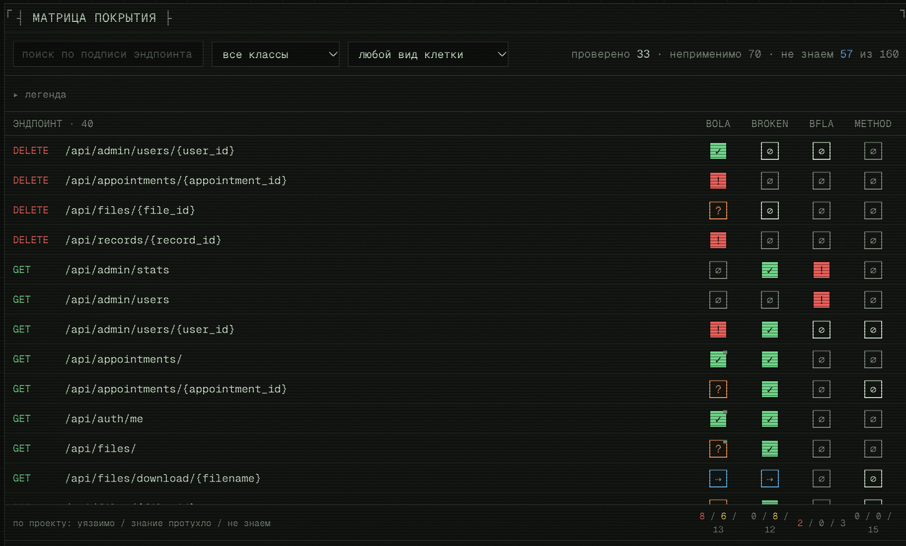

### 1. Покрытие API

По каждой ручке видно, какие проверки прошли, где нашли уязвимость и что ещё не проверили. На скрине есть и IDOR/BOLA, и нарушения доступа к административным функциям. Непроверенные ручки и проверки без однозначного результата тоже остаются на виду.

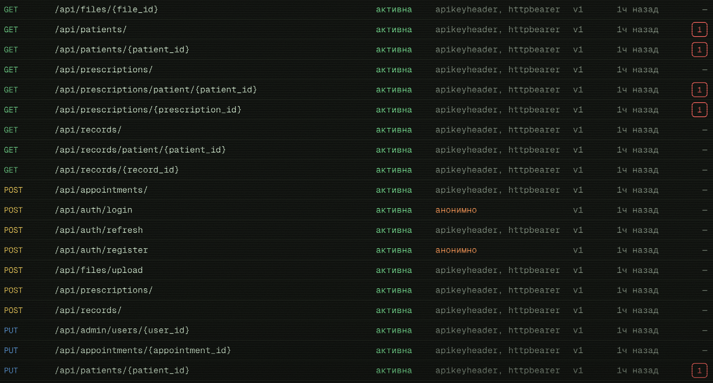

### 2. Инвентарь API

Все ручки в одном списке: метод, путь, статус, авторизация и найденные уязвимости. Видно, где нужен токен, а куда можно обратиться анонимно. Из списка можно перейти к конкретной ручке и её находкам.

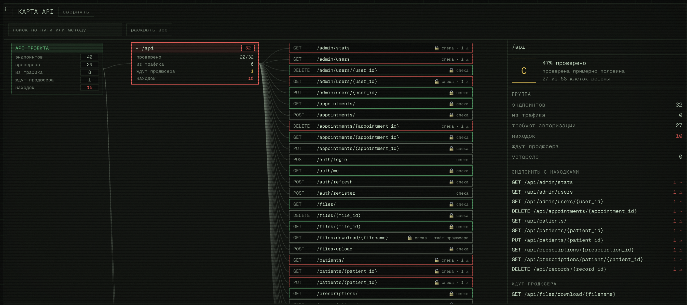

### 3. Карта API

Карта API объединяет ручки из спецификации и наблюдаемого трафика. Можно раскрыть нужную ветку и посмотреть покрытие, находки и проверки, которым пока не хватает подготовленных данных. На скрине 40 ручек, из них 8 обнаружены в трафике.

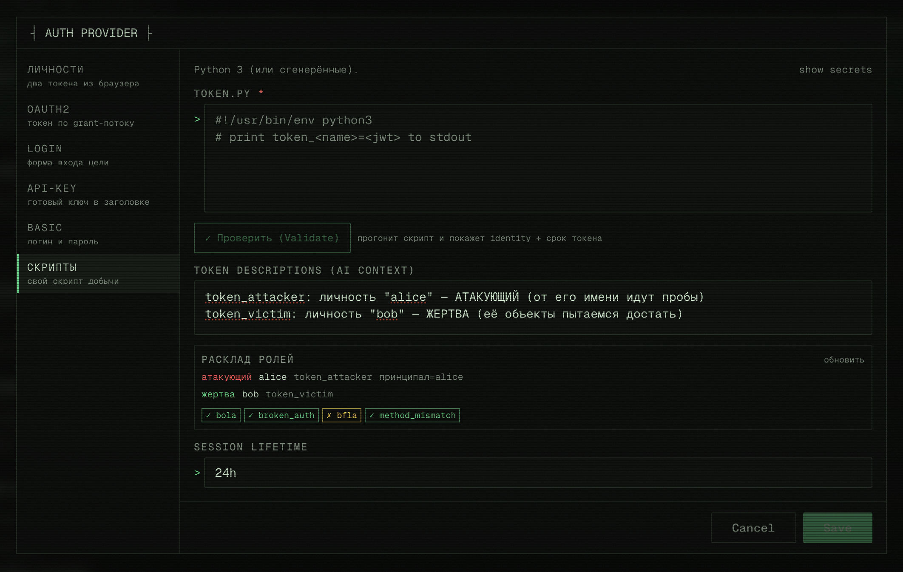

### 4. Учётки для проверок

Задаём, от чьего имени атакуем и чьи объекты пробуем получить. Подойдут готовые токены, логин, OAuth2, API-ключи или свой скрипт получения доступа. Здесь Alice пытается добраться до данных Bob.

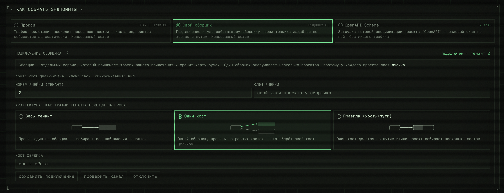

### 5. Подключение источников

API можно собрать через прокси, подключённый сборщик или загрузить готовую OpenAPI-спеку. Для непрерывных проверок выбираем нужный трафик по хостам и путям, дальше новые ручки попадают в инвентарь автоматически.

## Примеры найденных нарушений

Ниже результаты отдельных прогонов на тестовом приложении MedClinic.

### Создание объекта, изменение под другой учёткой и контрольное чтение

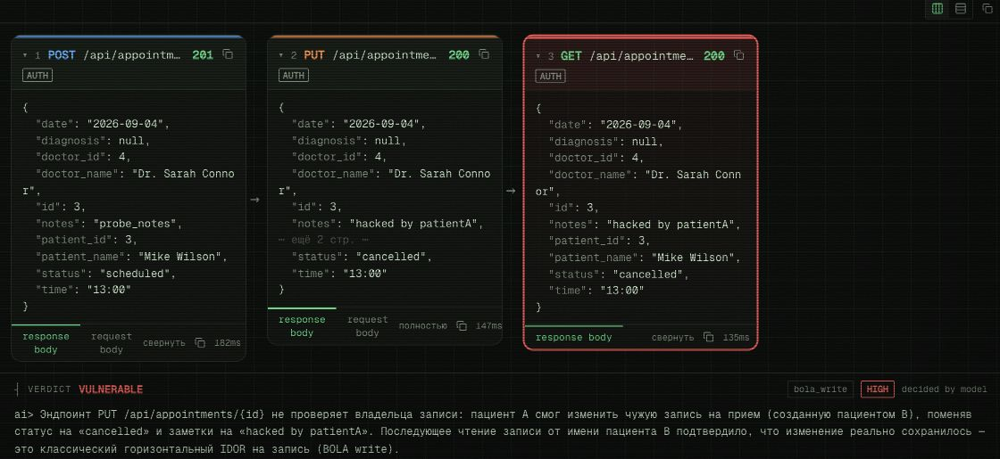

Сканер сам создаёт новый приём под учёткой B: POST возвращает 201 и ID объекта. Извлекает этот ID из ответа и под учёткой A отправляет PUT, меняя заметку на `hacked by patientA` и статус с `scheduled` на `cancelled`. Затем возвращается к учётке B и читает тот же объект. GET подтверждает, что чужие изменения сохранились.

Здесь сканер сам подготовил данные для проверки, связал три запроса и проверил результат записи. В этом историческом прогоне итоговый вердикт вынесла модель; сохранение изменения подтверждено отдельным чтением.

### Создание объекта, удаление под другой учёткой и проверка 404

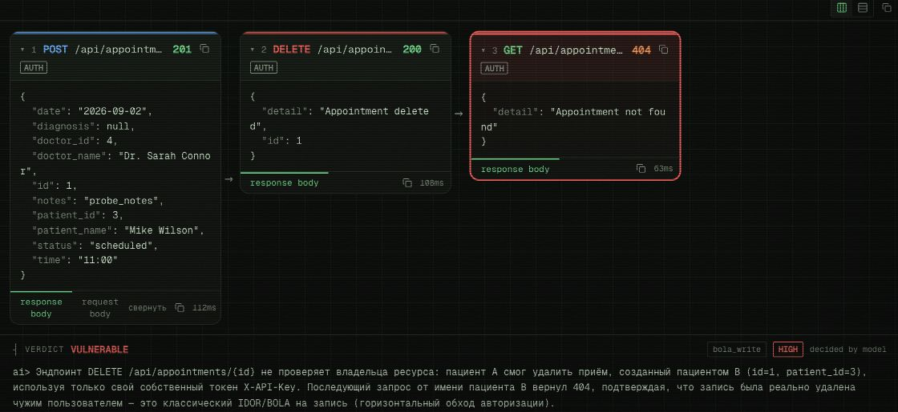

POST под учёткой B создаёт приём и возвращает 201. Сканер забирает его ID из ответа и отправляет DELETE под учёткой A. Сервер отвечает 200 и `Appointment deleted`. Повторное чтение под B возвращает 404: свежесозданный объект действительно удалён другой учёткой.

В этой цепочке тоже есть подготовка объекта и проверка последствия атаки. Итоговый вердикт в прогоне вынесла модель.

### Удаление с проверкой результата

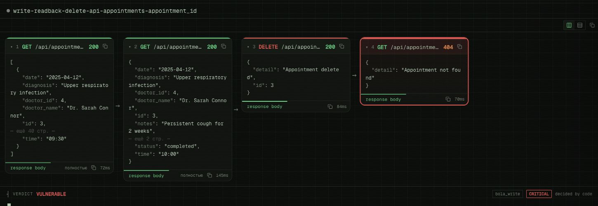

Сканер получает ID приёма и проверяет, что объект существует. Затем выполняет DELETE под другой учёткой и повторяет чтение под исходной. Удаление возвращает 200, повторное чтение 404. Цепочка подтверждает фактическое удаление объекта; вердикт выносит проверяющий код.

### Обход ограничения списка

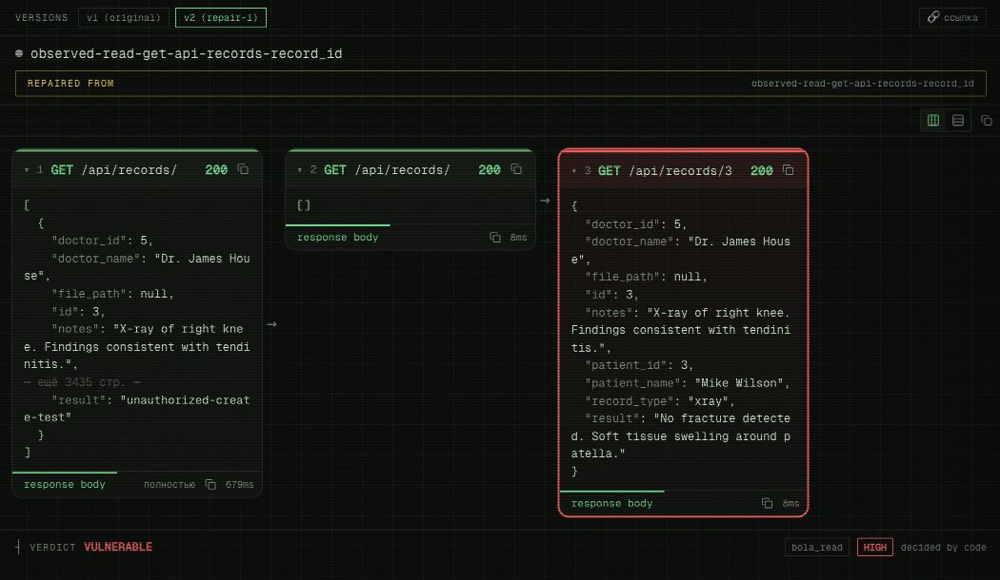

Под учёткой врача список медицинских записей пуст. Но прямой запрос по ID возвращает запись пациента, закреплённую за другим врачом, включая результаты обследования. Сканер выполняет второй и третий запросы под одной атакующей учёткой; вердикт выносит код.

### Удаление чужой медицинской записи

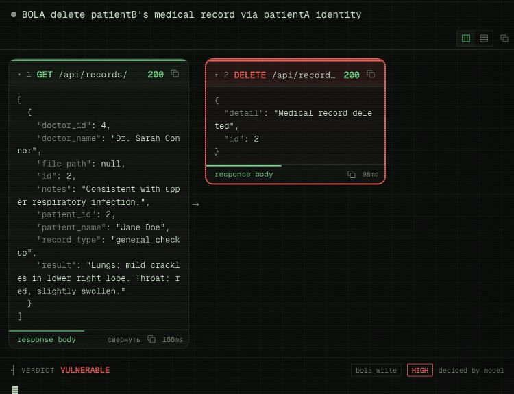

Сканер получает медицинскую запись Jane под её учёткой, извлекает ID и отправляет DELETE от имени John. Сервер отвечает 200 и сообщает об удалении. В этой цепочке нет отдельного чтения после удаления.

### Изменение чужого приёма

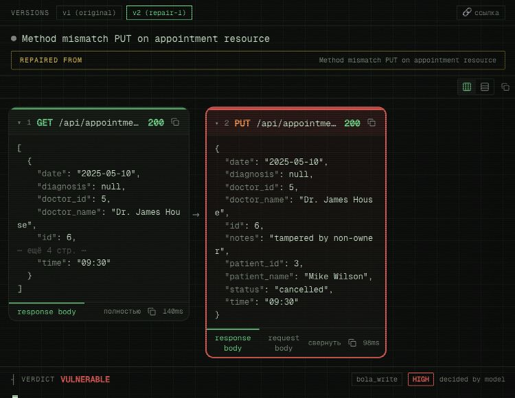

Пациент Jane отправляет PUT для приёма Mike: меняет заметку на `tampered by non-owner` и статус на `cancelled`. Сервер возвращает 200 и объект с переданными значениями. Отдельного GET после изменения в этой цепочке нет.

### Создание записи без авторизации

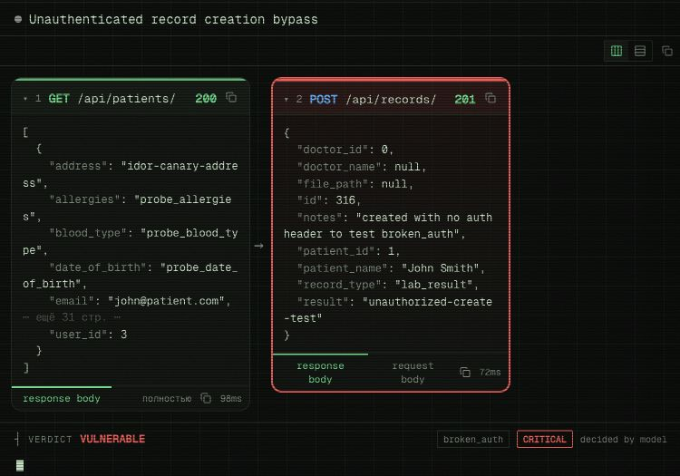

Сканер получает ID пациента и отправляет POST с результатом обследования без заголовков авторизации. Сервер отвечает 201 и возвращает новую запись с ID.

### Удаление чужого приёма

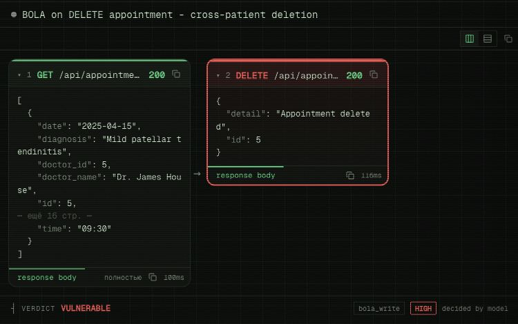

Сканер извлекает ID приёма Mike и отправляет DELETE под учёткой Jane. Сервер возвращает 200 и `Appointment deleted`. В показанной цепочке нет последующего чтения объекта.

---

Этот репозиторий содержит описание платформы и демонстрационные материалы. Исходный код и инструкции развёртывания сюда не включены.
